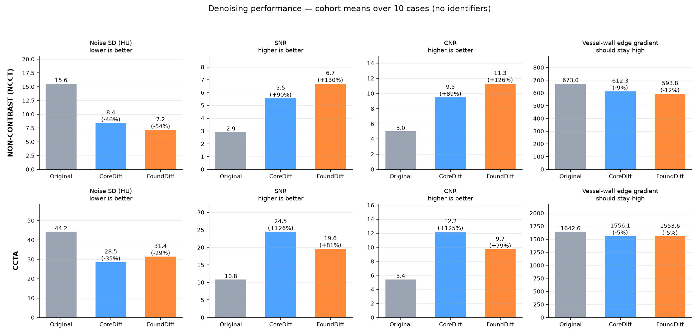
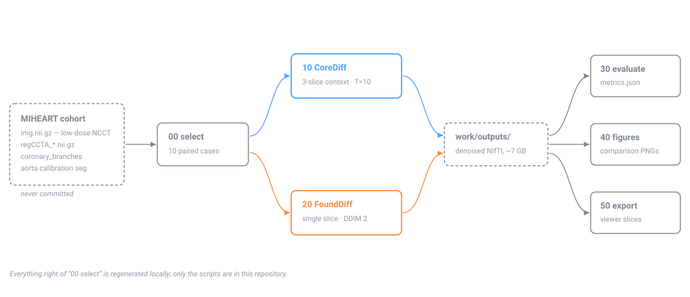

# Diffusion denoising for coronary CT — MIHEART

Enhance MIHEART paired coronary CT with pretrained low-dose-CT diffusion
denoisers, and compare the result against the registered CCTA.

> **No patient data is committed here.** Images, metrics and MIHEART accession
> identifiers are all excluded — a clone gives you code and documentation only.
> Running the pipeline requires local access to the cohort.
> See [docs/data-and-privacy.md](docs/data-and-privacy.md).

## The framing

FoundDiff, CoreDiff and NEED are all **LDCT denoisers** — they map noisy
low-dose CT to normal-dose CT. None of them synthesises contrast. So the
non-contrast calcium-score scan (`img.nii.gz`, the genuinely low-dose
acquisition) is the input to enhance, and `regCCTA_*.nii.gz` is the
**anatomical reference** for where the coronaries are, *not* a supervised
target. Both volumes were run through both models.

## Results — 10 cases, mean over cases

### Non-contrast (NCCT)

| variant | noise SD (HU) | SNR | CNR | edge grad | calcium FP |
|---|---|---|---|---|---|
| original | 15.55 | 2.92 | 5.00 | 673.0 | 108 |
| CoreDiff | 8.39 (**−46%**) | 5.54 (+90%) | 9.47 (+90%) | 612.3 (−9%) | 27 |
| FoundDiff | 7.16 (**−54%**) | 6.70 (+130%) | 11.30 (+126%) | 593.8 (−12%) | 37 |

### CCTA

| variant | noise SD (HU) | SNR | CNR | edge grad |
|---|---|---|---|---|
| original | 44.20 | 10.80 | 5.42 | 1642.6 |
| CoreDiff | 28.53 (**−35%**) | 24.45 (+127%) | 12.21 (+125%) | 1556.1 (−5%) |
| FoundDiff | 31.39 (**−29%**) | 19.58 (+81%) | 9.70 (+79%) | 1553.6 (−5%) |

FoundDiff denoises the non-contrast scan hardest; CoreDiff wins on CCTA.
Vessel-wall gradient drops only 5–12% against a 30–54% noise drop — the noise is
being removed rather than the vessel edges. Mean HU is preserved to within
~0.6 HU on NCCT (3.3 HU on CCTA), which is what makes calcium scoring still
valid afterwards.



Full discussion and caveats: [docs/results.md](docs/results.md).



## Documentation

| | |
|---|---|
| [setup.md](docs/setup.md) | environment, upstream repos, checkpoints, data layout |
| [pipeline.md](docs/pipeline.md) | what each of the six scripts does and why |
| [models.md](docs/models.md) | CoreDiff vs FoundDiff — architecture, sampling, quirks |
| [metrics.md](docs/metrics.md) | how the ROIs are built and what each metric means |
| [results.md](docs/results.md) | full numbers, interpretation, limits |
| [viewer.md](docs/viewer.md) | the web viewer, including before/after swipe |
| [data-and-privacy.md](docs/data-and-privacy.md) | **what is and is not committed here** |
| [troubleshooting.md](docs/troubleshooting.md) | failures hit in practice and their causes |
| [need-status.md](docs/need-status.md) | why NEED could not be run |

## Layout

```
scripts/      00 select · 10 CoreDiff · 20 FoundDiff · 30 evaluate · 40 figures · 50 viewer export
docs/         the documentation set above
viewer/       index.html — the synchronized web viewer

              ---- generated locally, never committed ----
work/outputs/   denoised NIfTI volumes (~7.0 GB)
work/figures/   comparison figures
work/*.json     metrics and case lists (MIHEART accession IDs)
viewer/slices/  exported PNG/JPEG slices (~420 MB)
viewer/*.json   viewer manifest and metrics (case IDs)
logs/           run logs

              ---- fetched, not vendored (docs/setup.md) ----
repos/          FoundDiff, CoreDiff, NEED at pinned commits (scripts/clone_upstream.sh)
weights/        FoundDiff/{DA-CLIP.pth, model-400.pt}, CoreDiff/ema_model-150000
envs/diffct/    venv, torch 2.8.0+cu128, mamba_ssm (requirements.txt)
```

## Quick start

```bash
./scripts/clone_upstream.sh                     # upstream model source at pinned commits
# download checkpoints into weights/           # see docs/setup.md
python3.11 -m venv --system-site-packages envs/diffct
envs/diffct/bin/pip install -r requirements.txt
# point ctio.ROOT at your copy of the data     # see docs/setup.md
```

## Reproduce

```bash
envs/diffct/bin/python scripts/00_select_cases.py
envs/diffct/bin/python scripts/10_run_corediff.py  --modalities ncct ccta --batch 8
envs/diffct/bin/python scripts/20_run_founddiff.py --modalities ncct ccta --batch 4
envs/diffct/bin/python scripts/30_evaluate.py
envs/diffct/bin/python scripts/40_figures.py
envs/diffct/bin/python scripts/50_export_viewer_slices.py
```

Roughly 70 minutes of GPU time for 10 cases × 2 modalities × 2 models. Both
inference steps skip outputs that already exist, so a crashed run resumes.

## Viewer

```bash
./scripts/serve_viewer.sh
```

then open <http://localhost:8712>. Bound to 127.0.0.1 only — these are patient
images, so it is deliberately not exposed on the network. From another machine,
tunnel it:

```bash
ssh -L 8712:localhost:8712 <this-host>
```

One slice index drives every panel. Wheel = scroll slices, drag = pan,
ctrl+wheel = zoom, ←/→ = step, space = cine.

**Swipe** is one of the panels: tick it in the Panels menu and it takes a cell
in the grid, holding two registered layers behind a draggable divider. Pick any
two panels for its sides, drag the blue line to wipe between them, double-click
to recentre. The HU readout follows whichever side the cursor is on. It is on
by default, in place of the CCTA panel.

State lives in the URL (`?case=…&z=…&panels=…&w=…&l=…&mask=1&sa=…&sb=…&sx=…`)
so a specific comparison can be linked. Details in [docs/viewer.md](docs/viewer.md).

## Segmentations used

All were already present in each case folder — nothing was segmented here.

| file | used for |
|---|---|
| `coronary_branches.nii.gz` | vessel ROI for CNR / edge / calcium metrics; red overlay in viewer; picks the display slice; case-selection ranking |
| `ai_cac_aorta_calibration_seg.nii.gz` | eroded aortic lumen = homogeneous ROI for noise SD, SNR, HU bias, calcium false positives |
| `whole_heart.nii.gz` | early sanity checks only; not in the reported metrics |

## Model settings

| | FoundDiff | CoreDiff |
|---|---|---|
| checkpoint | `model-400.pt` EMA @ step 300k + `DA-CLIP.pth` | `ema_model-150000` (Mayo 2016, 25% dose) |
| input | single 512² slice | 3-slice context (z−1, z, z+1) |
| HU normalisation | clip [−1000, 2000] → [0,1] | clip [−1024, 3072] → [0,1] |
| sampling | residual DDIM, 2 steps | cold-diffusion DDIM, T=10 |
| runtime | ~115 s / 256-slice volume | ~85 s / 256-slice volume |

FoundDiff clamps HU at −1000, so air outside the body is raised from ~−3000 to
−1000. Irrelevant inside the heart, visible as a bright ring in the difference
panels.

Neither repo's training entry point is usable as shipped — FoundDiff's
`train.py` has an undefined `folder` variable and hard-coded Mayo `.npy` paths,
and CoreDiff's `models/__init__.py` pulls in wandb and a perceptual loss that
inference does not need. Both models are therefore driven directly from the
released weights. See [docs/models.md](docs/models.md).

## NEED

Not runnable — see [docs/need-status.md](docs/need-status.md). No pretrained
weights are released, `torch_radon` has no build for CUDA 13 / torch 2.8, and
MIHEART has no projection data for the SPDiff stage.

## Licence and attribution

The code in `scripts/` and `viewer/` is this project's. The upstream models are
not vendored here — they are cloned at pinned commits by
`scripts/clone_upstream.sh` and remain under their own licences:

- CoreDiff — [qgao21/CoreDiff](https://github.com/qgao21/CoreDiff)
- FoundDiff — [hao1635/FoundDiff](https://github.com/hao1635/FoundDiff)
- NEED — [qgao21/NEED](https://github.com/qgao21/NEED)

Checkpoints are redistributed by their original authors, not from here.
